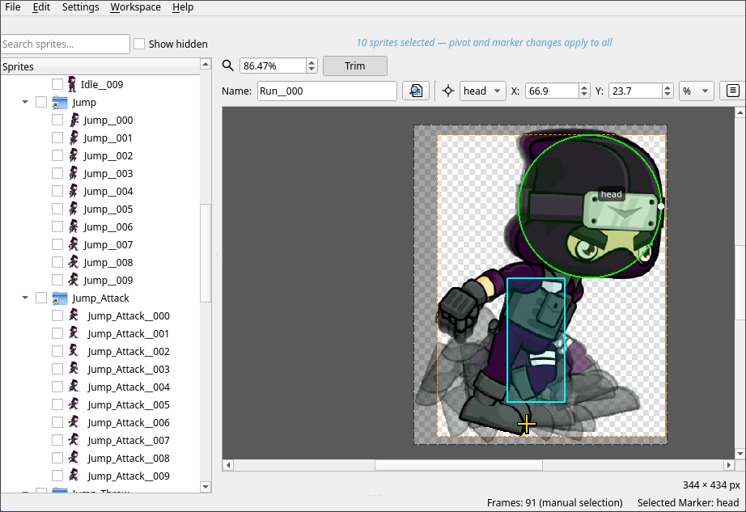

# Sprat-gui

GUI frontend for [`sprat-cli`](https://github.com/pedroac/sprat-cli) to build sprite sheets and their metadata (animations, markers, nine-slices, puppets) for games and UIs.

## Features

- **Sources**: load sprites from folders, archives (ZIP/tar), single images and sprite sheets (with automatic frame detection), animated GIFs or URLs, and keep the project in sync with them.
- **Atlases**: split sprites into atlases and pack them with per-profile options (GPU compression, dilation, deduplication).
- **Sprites**: place pivots and markers (points, circles, rectangles, polygons) on each frame, with onion skinning and flipbook mode.
- **Animations**: build timelines by hand or from frame names (`Run_0`, `Run_1`...), preview them, and export GIF or video.
- **Nine-slices**: define stretchable regions for UI elements such as buttons and panels.
- **Puppets**: build cutout rigs from sprites, pose them and animate the poses.
- **Projects**: save the whole state to a project folder (or open one from a `.zip`), with autosave and undo.
- **Export**: write atlases and metadata for your engine through sprat-cli's transforms.

If your pipeline is already fully scripted, you may not need this. If you want fast visual iteration on game or UI assets, it is likely useful.

## Try online

The **[web version](https://pedroac.itch.io/sprat)** runs in your browser with no installation. Frame detection and GIF/video export need the desktop version.

## Download and install

Pre-built binaries are on **[itch.io](https://pedroac.itch.io/sprat)**, with the sprat-cli tools included.

- **Linux**: download `sprat-gui-linux.AppImage`, make it executable (`chmod +x`), and run it
- **Windows**: extract `sprat-gui-windows.zip` and run `sprat-gui.exe`
- **macOS**: drag `sprat-gui.app` to **Applications**

Optional for advanced features:
- ImageMagick for GIF export
- FFmpeg for video export

**[Quick Start →](docs/getting-started.md)** 5-minute walkthrough to create your first atlas

For detailed guides or to build from source, see [Documentation](#documentation) below.

## Documentation

**Start here**: [Getting Started](docs/getting-started.md) — 5-minute intro

**Workspaces**:
- [Sprites](docs/workspace-sprites.md) — Import and edit sprites
- [Atlases](docs/workspace-atlases.md) — Organize and pack
- [Animations](docs/workspace-animations.md) — Create and preview
- [Nine-Slice](docs/workspace-nine-slice.md) — Scalable UI elements
- [Puppets](docs/workspace-puppets.md) — Character rigs
- [Export](docs/workspace-export.md) — Final export

**Concepts**:
- [Sources](docs/sources.md) — Loading and syncing sprites
- [Projects](docs/projects.md) — Save, load, autosave
- [Profiles](docs/profiles.md) — Compression and optimization
- [Shortcuts](docs/shortcuts.md) — Keyboard and mouse controls
- [Troubleshooting](docs/troubleshooting.md) — Common issues

**For developers**:
- [Building from source](docs/building.md)
- [Contributing](CONTRIBUTING.md)
- [Architecture Guide](AGENTS.md)
- [Changelog](CHANGELOG.md)

## Attribution

- Screenshots use the [“Adventurer Girl – Free Sprite”](https://opengameart.org/content/adventurer-girl-free-sprite) pack by pzUGH from OpenGameArt, reused under the original license.
- Core CLI tooling comes from the [`sprat-cli`](https://github.com/pedroac/sprat-cli) repository.
- Icons adapted with AI (Claude, Anthropic) from icons first taken from [SVG Repo](https://www.svgrepo.com).
- The smoke test's sample sprites (`tests/assets/streets_of_fight_files.zip`) are by Luis Zuno, redistributable per the license file in the archive.

## License

MIT. See [LICENSE](LICENSE).

## Support

