# Sprat GUI user guide

How each part of Sprat GUI works. For a first look, see the [README](../README.md); for keys, see [Keyboard and pointer controls](shortcuts.md).

- [Workspaces](#workspaces)
- [Sources, settings and projects](#sources-settings-and-projects)
- [Adding and excluding frames on the layout](#adding-and-excluding-frames-on-the-layout)
- [Timeline auto-generation naming](#timeline-auto-generation-naming)
- [Web version limitations](#web-version-limitations)
- [Troubleshooting](#troubleshooting)

## Workspaces

The application is organized into dedicated workspaces, each focusing on a specific part of the asset creation pipeline. You can switch between them using the tabs at the top of the window or keyboard shortcuts.

### Sprites Workspace (`Alt+S`)
The default workspace for importing assets, managing the sprite tree, and editing individual frame metadata (pivots and markers). Use this for the initial setup and fine-tuning of your sprites.

- **Sprite tree** (left)
  - Lists every source (folder, archive, image or URL) and its sprites, by folder; sprites with similar names are grouped. The search field above it filters sprites by name, and **Add Source** adds another source. Thumbnails load in the background, so large projects open quickly.
  - Tick sprites individually or by folder; right-click for context actions, or press `Delete` to exclude the selected sprites:
    - **Exclude** sprites, a group or the selection (they move to the source's Excluded node, from which they can be included again).
    - **Detect frames...** in an image.
    - Add frames into a folder.
    - Create a timeline from a group or from the selected sprites, add the selected sprites to the current timeline, or **Auto-create timelines**.
    - On a source: **Sync Source to Layout**, **Sync Layout to Source...**, **Retry** a source that failed to load, or **Remove source** (see [Sources, settings and projects](#sources-settings-and-projects)).

- **Selected Frame Editor**
  - Click any sprite in the tree to open its editor on the right; with nothing selected, the canvas says so.
  - Place and adjust **pivots** (origin/anchor points) and **markers** (named points for collision zones, spawn origins, etc.) directly on the frame image. With the pivot selected, clicking the image places it there; with a marker selected, clicking elsewhere on the image moves the marker there (centred on the click), and clicking the pivot's crosshair selects the pivot. A marker added in the Markers window becomes the selected one.
  - **Onion Skinning**: displays semi-transparent ghost overlays of neighbouring frames so you can align pivots and markers consistently across a sequence.
  - **Flipbook Mode**: keeps the pivot visually stationary while you step between frames, making it easier to spot drift across an animation.
  - See [Sources, settings and projects](#sources-settings-and-projects) for configuration options (opacity, zoom-on-frame-change, flipbook scope).

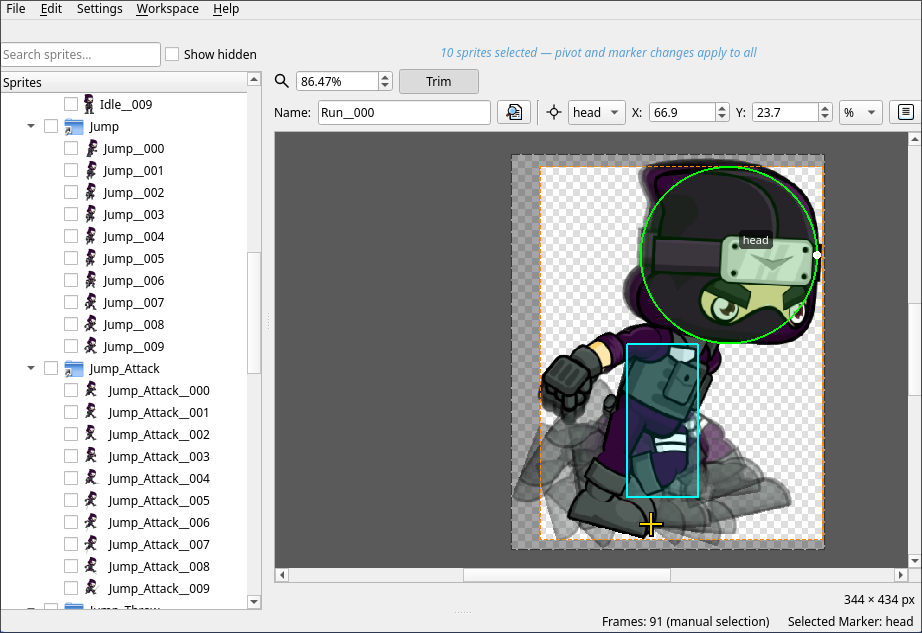

### Atlases Workspace (`Alt+A`)
Organizes sprites into atlases and shows how each one packs. Projects with a single atlas can leave everything in **Default**.

- **Atlases** (left): add, remove and rename atlases. **Excluded** holds the sprites left out of every atlas.
- **Sprite tree** (middle): tick sprites (`Ctrl+Click`, or `Shift+Click` for a range) and drag them onto an atlas. Right-click:
  - an atlas: move the ticked sprites to it;
  - a folder or group: create an atlas from it, or move it to the atlas of the same name;
  - a source: autocreate one atlas per subfolder.
- **Right panel**: **Navigation** shows the tree, **Layout** the selected atlas packed (zoom with `Ctrl+Wheel`, pan with `Space+Drag`); the atlas's name, source resolution, packing statistics and the **Profiles** it is exported with. The layout rebuilds a second after you stop making changes.

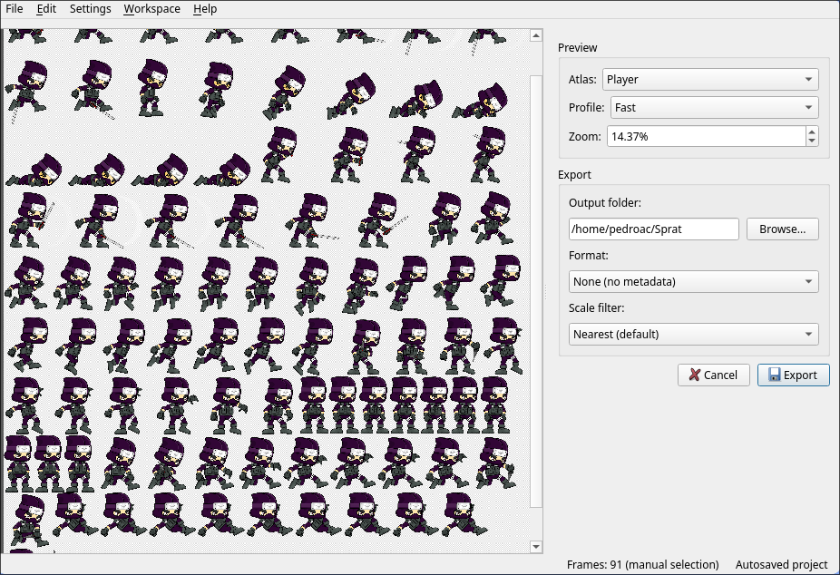

### Nine-Slice Workspace (`Alt+N`)
An interactive editor for defining nine-slice (nine-patch) configurations on individual sprites. Useful for scalable UI elements such as buttons and panels that must stretch without distorting corners.

- **Left panel**: the nine-sliced sprites, with a text filter, and **Add** / **Remove** buttons under them.
  - **Add** opens a sprite picker listing the other sprites, with a preview. Tick one or more sprites, or a whole folder (Shift+click ticks a range), and click **Add**. New sprites start with slice lines at image thirds.
  - **Remove** (or `Delete`) stops nine-slicing the selected sprites. Their insets are kept, so adding a sprite again restores them.
- **Right panel**:
  - **Insets** — L / T / R / B spinboxes (px) to set left, top, right, and bottom slice lines.
  - **Fill modes** — separate horizontal (H) and vertical (V) combos: *stretch*, *repeat*, *mirror*, or *fixed* (keeps the sprite's size on that axis).
  - With no sprite selected, the canvas says what to do and **W** / **H** are off.
  - **Zoom** — 10–1600 % zoom for the editor canvas.
  - **Target size** — W / H spinboxes (1–4096 px) to preview the nine-slice result at a given render size. Drag the right/bottom/corner handles on the canvas to resize interactively.
  - **Grid** — toggles a pixel grid overlay.
  - **Colorize** — shows colored region hints (corners, left/right edges, top/bottom edges, center).
- **Canvas**: displays the slice lines as draggable handles and renders a live composite at the target size. Supports zoom (`Ctrl+Wheel`) and pan (`Space+Drag` or `Middle Mouse Drag`).

Nine-slice definitions are saved in the project file and included in atlas metadata on export. Editor appearance (line color, style, region colors, overlay opacity) is configurable in **Settings → Nine-Slice**.

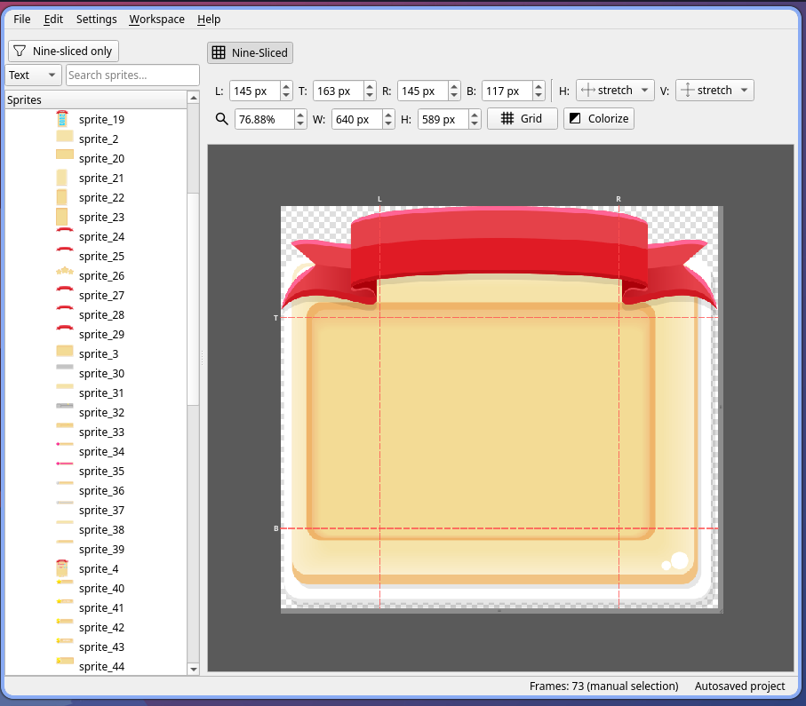

### Frame Animation Workspace (`Alt+F`)
Focuses on timeline authoring and animation preview: the timeline list on the left, the selected timeline and its preview on the right. Sprites are picked in dialogs, so the workspace doesn't need the sprite tree.

- **Animation authoring**
  - Timelines panel lists all animations with detailed info: `<name> | <frames count> frames | <fps> fps`. With several atlases, **Atlas** picks whose timelines are listed; a timeline's frames come from its atlas.
  - **Add timeline** (the button next to the name field) opens a sprite picker: tick the sprites, or a whole group, and press **Create**. Create with nothing ticked makes an empty timeline.
  - Right-click the timeline list and choose **Auto-create Timelines...** to pick one or more groups (Ctrl/Shift+click; a source counts as a group). Each group that holds sprites, the picked ones or any inside them, becomes a timeline named after it, in folders named after the source and the groups above it. Picking `Mascot.zip`, which holds groups `run` and `idle`, gives timelines `run` and `idle` in a `Mascot.zip` folder.
  - Right-click a frame and choose **Add Frames Before...** or **Add Frames After...** to insert sprites there; right-click empty space in the frames for **Add Frames...** at the end. Picked sprites are added in number order (`walk2` before `walk10`).
  - The **Selected Timeline** group provides controls to rename, adjust FPS, and manage the frame sequence ("tape").
  - **Play** sets how the animation plays, in the preview and in exported metadata: **Loop** (repeat), **Once** (stop on the last frame), **Ping-pong** (forward then backward, repeated) or **Ping-pong once** (forward then backward, then stop on the first frame). An alias plays the way its source does. Engines with their own ping-pong (Phaser, Aseprite) get it as a setting; Godot and Unity get the way back as extra frames.
  - Reorder frames by dragging them or with the context menu; duplicate or remove them from the context menu.

- **Animation test area**
  - Play/pause/step controls plus timeline FPS and zoom controls.
  - Supports wheel scrolling, `Ctrl+Wheel` zoom, and panning (`Middle Mouse Drag` or `Space + Left Drag`).
  - Use “Save Animation…” (right-click preview) after choosing ImageMagick/FFmpeg toolchains.

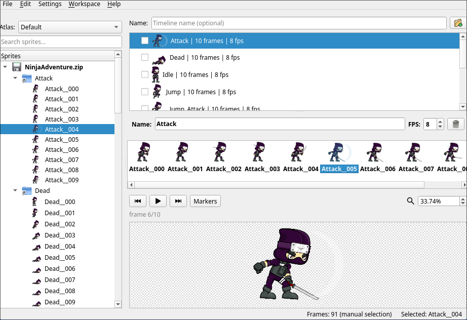

### Puppet Workspace (`Alt+P`)
Builds sprat-cli puppets: cutout rigs whose parts each show one of their sprites, joined at markers. A puppet belongs to an atlas and uses its sprites; with several atlases, **Atlas** above the tree picks whose puppets are listed.

- **Left panel**: the puppets tree, puppet › part › variant (a sprite the part can show).
  - Parts are listed in draw order: the first is drawn at the back. The column next to a part says where it goes: `at X,Y` for a part placed by position, `↳ PARENT:MARKER` for one hanging from another part's marker.
  - ★ marks the variant each part shows on the canvas: in the selected pose, the edited animation frame, or where the animation's playhead is (for other puppets, the rest variant). The rest variant, the first one, is the one the **rest** pose shows; to change it, select **rest** below the canvas and pick another variant; it moves first.
  - To have the selected pose show a variant, double-click the variant in the tree, right-click it for **Show in Pose**, or pick it in the part's **Shows** (right panel). In bold with "· shown", the variant the selected pose shows (for parts with more than one).
  - Drag a part to change the draw order: its row lifts out and a gap opens where it will land (anywhere over the puppet's rows works: over a part's upper half puts it before that part, below the last row puts it last). Or right-click it, in the tree or on the canvas, for **Bring to Front**, **Bring Forward**, **Send Backward** and **Send to Back**. A part's variants are listed by name (`walk2` before `walk10`), in the tree and in **Shows**.
  - **Add** › **New Puppet** opens a window to name the puppet and build its parts: drag sprites (or a folder) from the list on the right onto a part to add them to it, or onto empty space to make one part showing them all, named after the folder or what the sprites' names share (`walk_01`, `walk_02` → `walk`); **Add Part** adds an empty one. Select several rows with `Ctrl`/`Shift`; right-click for **Rename Part**, **Delete Part** and **Exclude Sprites** (takes sprites out of their part); **Remove** or `Delete` does the same for the selection. **Create** adds the puppet as one undo step; **Cancel** changes nothing.
  - **Add** › **New Part** (placed at the puppet's origin) or **Add Sprites...** (pick sprites from the atlas for the selected part). **Remove** (or `Delete`) removes the selected puppet, part or variant; removing a part also removes the attachments to and from it.
  - Rename with `F2` or in the right panel. Names must be unique, as sprat-cli requires: puppets in the atlas, parts in their puppet, variants in their part.
- **Canvas**: the selected puppet at rest. **Grid** shows a grid from the puppet's origin, with the cell size, offset and colour set in Settings, to line parts up. The large cross is the puppet's origin; the small one, in a ring, is the selected part's pivot. Click a part to select it, and drag it to move it; parts hanging from it move along. The arrow keys move the selected part by one pixel (ten with `Shift`). A part hanging from another moves with that part, not on its own.
- **Trying the joints**: any part can be turned: drag the round handle at the end of the selected part's angle line, or type its **Angle** in the right panel's **Transformation** group (with **X** and **Y** for a part placed by position: what the selected pose does to the part). An attached part turns around its joint, from its parent and within its turn limits (freely without them); a part placed by position turns freely around its pivot.
- **Moving parts**: drag any part to move it. A part placed by position goes where you drop it: on **rest**, that is the rig's position; on another pose, the pose's. An attached part is pulled instead, so the point you hold follows the pointer, saved in the selected pose: its joint first slides within its parent's marker and leeway (a pupil in its eye socket), then it and the parts it hangs from turn within their limits, like moving a hand turns the forearm and the upper arm. `Shift`+drag an attached part to move its joint within its parent's marker and leeway. The selected part shows its turn range and where its joint may go.
- **Poses**: the strip below the canvas holds the puppet's poses, as thumbnails sharing one framing so they compare, starting with **rest**. Click a frame to edit it: turning, pulling, moving parts placed by position and picking the variant a part **Shows** (right panel) change that pose at once, each drag one undo step. **rest** is a pose like the others, exported as `pose "rest"`, so an animation can go back to it: it starts out setting every part as the rig has it (rest variant, angle 0, joints on their markers, parts placed by position where the rig puts them), and new parts join it. It always comes first and can't be renamed, moved or deleted; moving a part placed by position on it moves the rig too. Engines still start from sprat-cli's own rest (first variants, angle 0) until they play a pose. The strip works like an animation's frame list: **Add Pose** adds an empty pose after the selected frame and **Duplicate** copies it; right-click a frame for **Add Pose Before**, **Add Pose After**, **Move to the left**, **Move to the right**, **Duplicate** and **Delete** (rest only takes poses after it). Double-click a pose to rename it, drag it to reorder; **Delete**, `Delete` or `Backspace` deletes it (and the sequence steps that play it).
- **Animations**: the **Animations** tab below the canvas lists the puppet's animations (sprat-cli sequences): **Add**, **Delete**, double-click to rename, right-click to duplicate. The selected one shows its poses in order, each a block as wide as its frames: right-click it to **Add Pose** (on empty space, at the end), **Add Pose Before**/**After**, **Move to the left**/**right**, **Duplicate** and **Delete** (or `Delete`). Select a step to set its pose, **In** (frames to reach it), **Hold** (frames it stays) and ease (**Linear**, or **Step** to snap at the end); a part can ease its own way in the selected step (the eyes snap while the arm moves): select it and set **Ease** in the right panel's **Animation** group (**As step**, **Linear** or **Step**; off for parts the step's pose doesn't move). A step lasts a frame at least. The animation's **fps** and loop (**Loop**, **Once**, **Ping-pong**, **Once ping-pong**) sit next to **Play**. The canvas plays it: click a step to go where its pose arrives, drag on the steps to move the playhead. **Frames of its own**: right-click a step for **New Frame Before**/**After**: a new pose, a copy of that step's, that belongs to the animation (named after it, `walk frame 1`, `walk frame 2`...; renamed, duplicated and deleted with it, and gone once no step plays it). The Poses tab doesn't list them, and other animations can't add them. Stopped where a step's pose has arrived, the canvas edits that pose as the Poses tab does. A step playing a shared pose (one from the Poses tab, drawn with a dashed border) gets its own copy the first time you change it, so the shared pose and the animations that play it stay as they were; a note under the step says which it plays. **Save as Pose...** copies a step's pose to the Poses tab; double-clicking a step that plays a shared pose opens it there. **Onion skin** shows the steps before (red) and after (green) the edited one, faintly. Parts showing an animation (a talking mouth) play its frames at its own fps and loop mode as the preview plays, as an engine would; posing, they show its first frame. Tick other animations in the list to play them along, as a game would combine them (the later one wins where two set the same part).
- **Scale, opacity and tint**: on a pose (or an animation frame), the part panel's **Scale** stretches the selected part along its own axes around its pivot or joint (one factor for both while 🔗 is on; **Flip** turns an axis around), **Opacity** fades it (0 % hides it) and **Tint** multiplies its colors (white leaves them; ↺ goes back to white). They are the part's own: its children aren't scaled, faded or tinted, though they follow where its markers move. A part locked in the pose keeps them. Animations tween them, and **rest** sets them back for every part another pose changes.
- **What a pose sets**: under the puppet tree, the selected pose's parts are listed with what it sets (`head · 30°`, `×1.5`, `40 %`, `#ff8080`). A pose sets only its ticked parts, and of those only what you changed, so poses combine as sprat-cli plays them: a "legs" pose and a "smile" pose together. Parts it leaves alone are faint on the canvas, at rest; changing one ticks it, unticking one leaves it out again.
- **Markers**: every part's markers are drawn on the canvas, faintly, and the selected part's are labelled. The part's **Markers** list in the right panel sets which ones are shown and offered for joints (all of them to start with): untick the ones that are only for the game, such as hit boxes. This is saved in the project, not exported.
- **Attaching parts**: drag the selected part's pivot ring. The markers it can hang from appear, labelled; drop on one to hang the part there (it snaps on). Drop it on such a part away from its markers to add a point marker there, named after the part being hung, and hang the part from it by its pivot: every sprite the parent shows (each frame of its animations too) gets the marker at the same distance from its pivot, so check the other variants in the Sprites workspace if they aren't drawn alike. A parent showing a sprite that isn't in the atlas can't take one; the canvas says why. Or put the part where it goes first and double-click its pivot ring: it hangs, where it is, from a new marker on the part under its pivot; when several parts or none are under it, a menu asks which one. Drop elsewhere, or hold `Shift`, to place the part there by position. A part can't hang from itself or from the parts hanging from it. Markers are added to sprites in the Sprites workspace; every sprite also has a `pivot` marker, its pivot.
- **Locks**: the right panel's **Rig** group has a **Lock** that keeps how the part is placed from changing in every pose (what it hangs from, its leeway, limits and markers, and its position on Rest); the **Transformation** group's **Lock** keeps it as it is in the pose it edits ("In pose ...": what it shows, its position and angle), on the canvas too, and pulling a part below it bends only the joints below it. Other poses aren't locked. Locks are saved in the project, not exported.
- **Right panel**: the selected item's name; a variant's sprite and preview; and how a part is placed, **By position** (X, Y) or **Attached**: the part it hangs from, at which of its markers, by which of this part's markers (its pivot or a point marker; **New marker at its pivot** adds a marker to the parent where this part's pivot is, as dropping the pivot ring does), the **Leeway** its joint may drift when posed, and how far it may **Turn** from its parent. ⚠ marks a marker that some of the part's variants lack. Switching to **By position** keeps the part where it is. A ⚠ in the tree marks a part that can't be drawn (the panel says why) or a sprite that isn't in the atlas.

Every change can be undone.

### Exportation Workspace (`Alt+X`)
A full-screen preview and configuration area for final output. Preview exactly how your atlases will be packed and choose your metadata format before exporting to disk.

- Click the **Exportation** tab to open it, or use **File → Export** (`Ctrl+E`) for a quick re-export to the last used output folder.
- The left pane shows a live packed-atlas preview. Use the **Atlas** selector to preview individual atlases.
- The right pane selects the output folder, metadata format (transform), and scale filter. Click **Export** to run the full pipeline. To leave, click another workspace tab.

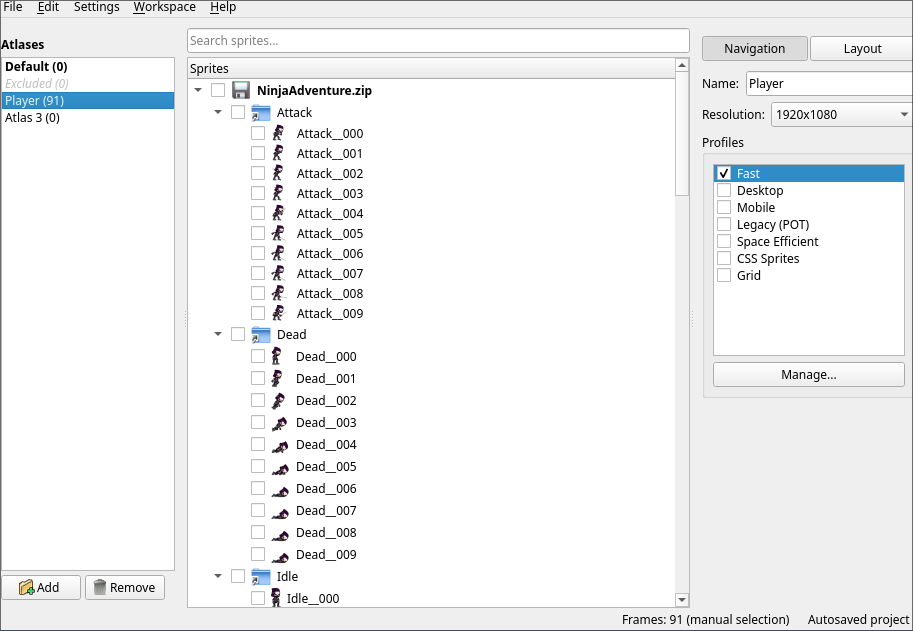

## Sources, settings and projects

- **CLI tools configuration / missing detection**
  - On first launch, if the required Sprat binaries are missing, the app displays a "CLI missing" status and prompts you to either point to existing binaries or download/install them automatically into `~/.local/bin`.
  - You can manually configure binary paths anytime in **Settings → CLI Tools**.

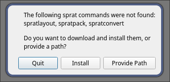

- **Visual customization & Synchronization**
  - **Nine-Slice Settings**: Configure the nine-slice editor appearance in **Settings → Nine-Slice** — slice line color and style, label color, resize handle color, per-region overlay colors (corners, edges, center), overlay opacity, and zoom-on-sprite-change behavior.
  - **Frames Editor Settings**: Configure workspace and sprite frame background colors, toggle the transparency checkerboard, and set sprite border styles in **Settings → Frames Editor**.
    - **Onion skin opacity**: Adjust the transparency of ghost overlays (0–100%).
    - **Flipbook pivot**: Choose which frames trigger flipbook alignment (None, Same Group, or All).
    - **Zoom on frame change**: Configure zoom behavior when switching frames (Fit to frame, 100%, or Keep previous).
  - **Atlas Sprites Settings**: Choose between **None**, **Manual** (sync on demand), or **Watch** (live file system monitoring) in **Settings → Atlas Sprites** to keep your project in sync with the source images folder.

- **Profile management with output processing**
  - Use **Manage Profiles** to create and configure layout profiles.
  - Each profile supports per-target output processing:
    - **GPU Compression**: Choose None, DXT1 (RGB, no alpha), or DXT5 (RGBA) for hardware texture compression. Output is saved as `.dds` when enabled.
    - **Dilate (Artifact Reduction)**: Apply pixel dilation passes (0–16) to bleed opaque pixels into transparent neighbors, reducing dark halos around trimmed sprites.
  - These settings are profile-specific; different targets can use different compression formats.
  - **Global Deduplicate**: Enable deduplication in Settings using **Exact** (byte-for-byte identical) or **Perceptual** (visually similar) modes to create aliases for duplicate sprites during layout generation.

- **Loading frame folders**
  - Use **File → Add Source Folder...** or drop a directory/ZIP/project file onto the window.
  - When loading a ZIP with multiple image directories, the app prompts you to choose the folder to import.

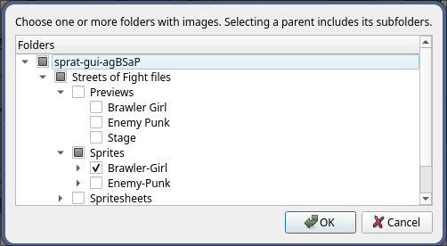

- **Frames detection**
  - When you drag and drop a single image file (like a sprite sheet or a strip), the app automatically runs `spratframes` to detect individual frames.
  - A dedicated dialog opens showing the identified frames. You can select exactly which ones to import.
  - **Splitting frames**: If the automatic detection merges two or more frames, use the **Split Mode** (right-click a frame or use the toolbar in the detection dialog) to manually divide them.
  - Click on a frame to place a splitting line; the view supports zoom for exact placement (CTRL + mouse wheel).
  - Once satisfied, accept the detection to extract and load the frames into your project.

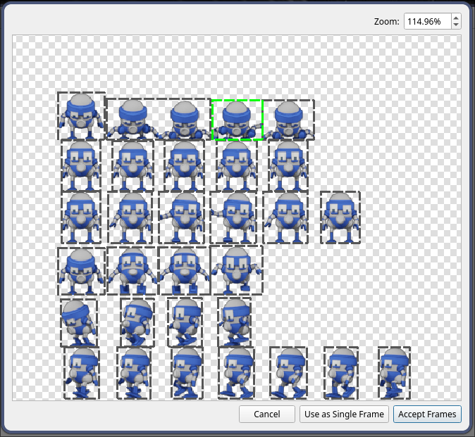
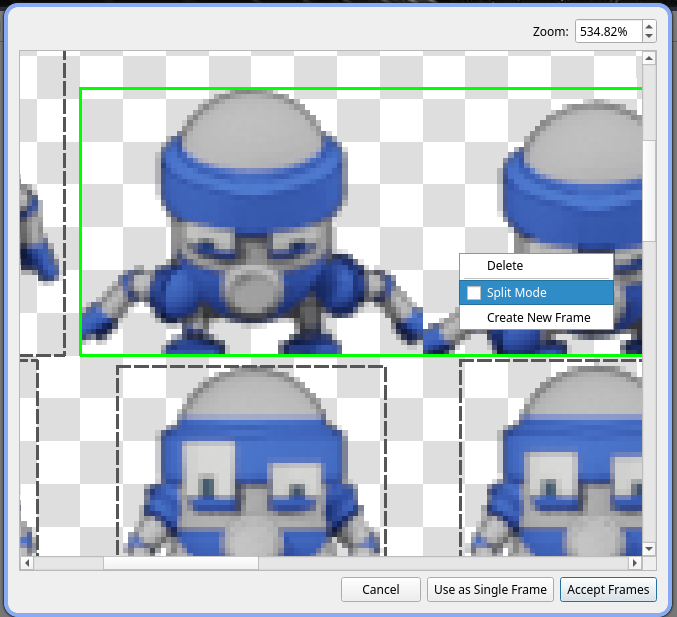
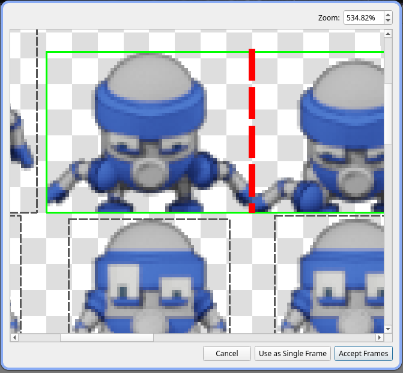

- **Sources management**
  - Each source (folder, archive, image or URL) is a top node of the sprite tree, with an icon for its type. Right-click it for:
    - **Sync Source to Layout**: lays the source out again as it is now; files the project has but the source lost can be put back, and files missing from both can be looked for in another folder. For a ZIP or TAR, files added to or changed in the archive aren't extracted yet.
    - **Sync Layout to Source...**: writes the current sprites back into the original file — repacks archives, re-renders PNG atlases, or re-exports GIFs. A confirmation shows what changes (files added / updated / deleted) before anything is written. Not available for URL sources.
    - **Retry** a source that failed to load, or **Remove source**.
  - **Settings → Atlas Sprites** keeps the project in step with the source folder: **Manual** (with **Sync Now**) or **Watch** (follows changes on disk).
  - If the original file has been moved or deleted, the app offers to recreate it from the cached copy, embed the live layout sprites into a new file, locate it from the filesystem, or remove the source entirely.
  - If individual files are missing inside an existing source, the app offers to restore them from the project cache or locate a replacement folder.

- **Project save/load**
  - **Save As** creates a project folder holding `project.spart.json` and, if you choose, a copy of the source images in `sprites/`.
  - **File > Open Project** (Ctrl+O) opens that folder and resumes layout, timelines, and editor context. **File > Open ZIP Project** opens a project packed in a ZIP. You can also drop a project folder or ZIP on the window.
  - **Autosave**: The application automatically saves a recovery snapshot of your project every 5 minutes, and the status bar says when it last did. If the app is closed unexpectedly, it will offer to restore the autosaved state upon the next launch.

- **Messages**
  - Errors and warnings put each idea in its own paragraph: what went wrong, what a sprat-cli tool said (in a fixed-width block, cut when long), and what to do.

## Adding and excluding frames on the layout

Use the layout canvas context menu (Atlases workspace, **Layout** view) to manage individual frames without reloading an entire folder. Right-click an empty area, choose **Add Frames...**, and pick one or more image files. The GUI writes a temporary plaintext list that `spratlayout` already understands (the same list-file input described in the [`sprat-cli`](https://github.com/pedroac/sprat-cli) README) and runs the layout using that list, so you can mix files from anywhere on disk. Right-click selected sprites for **Exclude Selected Frames**; if timelines use those frames, you are warned that the timelines will drop them first.

## Timeline auto-generation naming

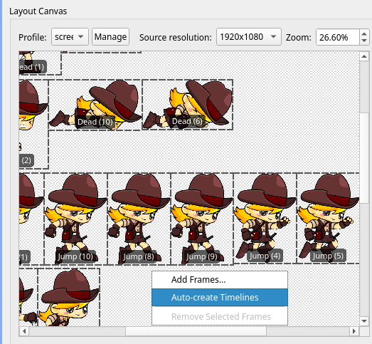 

Supported patterns:

```text
<Name> (<Index>)
<Name> [<Index>]
<Name>_<Index>
<Name> <Index>
<Name>-<Index>
<Name><Index>
```

Examples:

- `Idle (0)`, `Idle (001)`, `Idle [2]`
- `Run_0`, `Run 01`, `Run-2`, `Punch3`

Generation behavior:

- Creates timeline `<Name>` if it does not exist.
- Adds frames whose names end with a numeric index in one of the supported patterns.
- Sorts frames by `<Index>`.
- If a timeline exists, you can choose **Replace**, **Merge**, or **Ignore**.

## Web version limitations

The web version shares most functionality with the desktop build. The following constraints apply:

- **Frame detection and animation export unavailable**
  `spratframes`, ImageMagick, and FFmpeg are not available in the browser environment. Use the desktop version for GIF/video export or automatic frame detection.

- **File access via picker only**
  The browser sandbox restricts direct filesystem access; use **File → Add Source Folder...** or drag-and-drop files from your local machine.

## Troubleshooting

- **”CLI missing” at startup**
  The app will prompt you to install them automatically. Alternatively, open **Settings → CLI Tools** and set absolute paths for your own Sprat binaries.

- **Cannot save/load `.zip` project**
  ZIP handling is built in via libarchive. If saving still fails, check that the destination path is writable and that sufficient disk space is available.

- **Animation export disabled or failing**
  Install ImageMagick and/or FFmpeg, then restart the app.

- **Translations are not generated during build**
  Install `Qt6 LinguistTools`. Without it, the app still builds, but automatic `.ts/.qm` generation is skipped.
