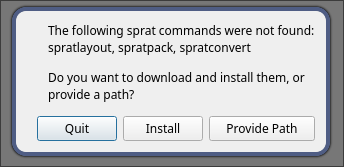
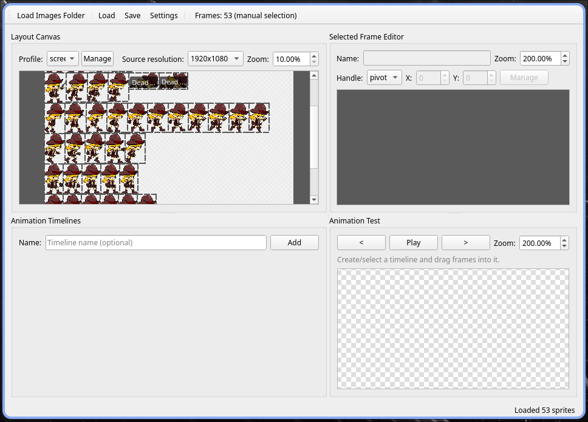
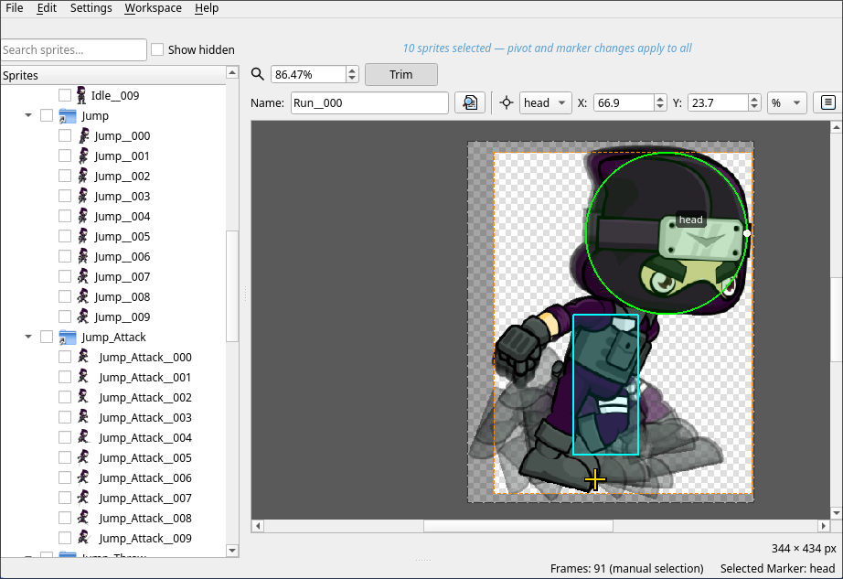
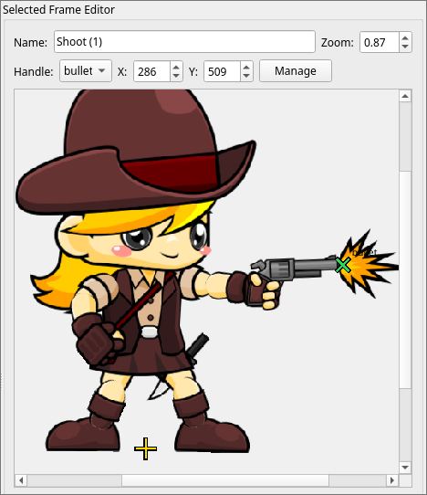
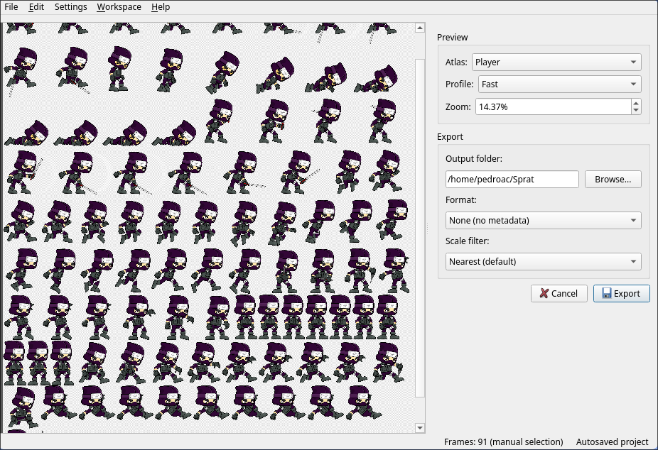
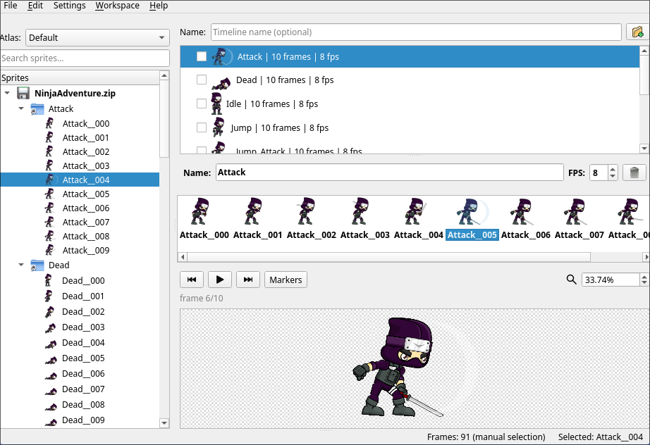
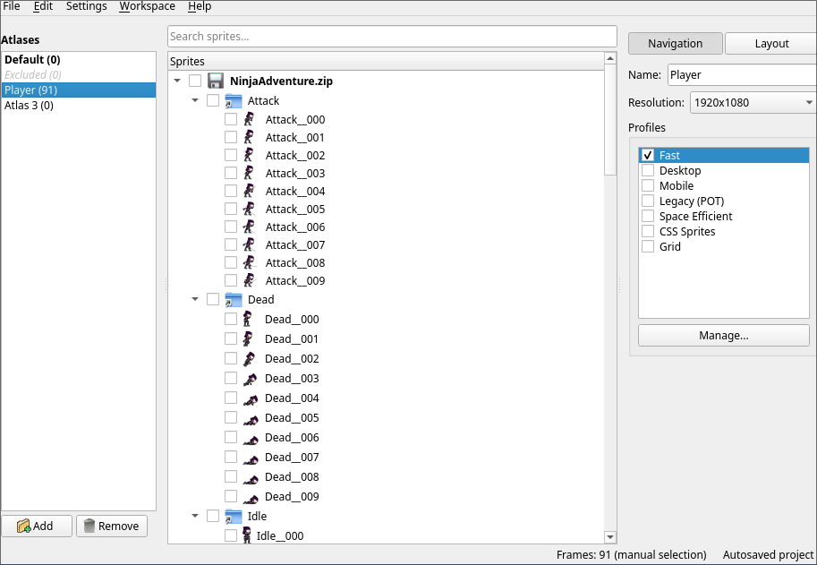

# Visual Guide: First 10 Minutes with Sprat GUI

A step-by-step walkthrough with screenshots. For more detail, see [Getting Started](getting-started.md).

---

## Step 1: Launch and Set Up

**Download** from [itch.io](https://pedroac.itch.io/sprat) and run the app.

On first launch, you'll see:

Click **Install**. The app downloads and sets up the tools (takes ~30 seconds).

---

## Step 2: Load Your Sprites

You now have a blank workspace. **Drag a folder of images** onto the window.

Or use **File → Add Source Folder...** if drag-and-drop doesn't work.

The sprites appear on the left side:

---

## Step 3: See the Sprites Tree

**Left panel** shows all your sprites, organized by folder.

Look for the **Sprites workspace** (Alt+S) — you're already there.

---

## Step 4: Pick a Sprite and Place Its Pivot

1. **Click a sprite** in the left list
2. The image appears on the right
3. **Click on the image** where the origin should be (usually center or bottom)

Done! You've placed the pivot.

Repeat for other sprites, or skip this for now.

---

## Step 5: Pack Into an Atlas

Press **Alt+A** to open the **Atlases workspace**.

Your sprites are already packed and ready:

**No action needed** — the app automatically packs them. You can split into multiple atlases here if needed, but for most projects, one atlas is fine.

---

## Step 6: Build an Animation (Optional)

Press **Alt+F** to open **Frame Animation** workspace.

Click **Add Timeline**:

1. A picker opens
2. **Tick sprites in order** (the order they animate)
3. Click **Create**

Now you have a timeline. Click **Play** to see it animate:

Adjust **FPS** if it's too fast or slow.

---

## Step 7: Export

Press **Alt+X** (or **File → Export**) to open **Exportation workspace**.

**Left panel** shows how your atlas will look. **Right panel** has settings:

1. Pick an **Output Folder** (where to save)
2. Choose **Metadata Format** (usually `json`)
3. Click **Export**

Done! Your atlas and metadata are saved:

The files are ready for your game engine.

---

## What You've Done

✓ Loaded sprites  
✓ Placed pivots  
✓ Packed an atlas  
✓ Created an animation  
✓ Exported everything  

**Time spent**: ~10 minutes

---

## Next Steps

**Add markers** (collision zones, spawn points):  
[Sprites Workspace](workspace-sprites.md) → **Add Markers** section

**More animations**:  
[Frame Animation](workspace-animations.md) → **Auto-Create from Naming** section

**UI scaling** (buttons that stretch):  
[Nine-Slice](workspace-nine-slice.md)

**Character rigs** (arms, legs, etc.):  
[Puppets](workspace-puppets.md)

**Save your work**:  
[Projects](projects.md)

---

## Tips

- **Undo**: Ctrl+Z works everywhere
- **Keyboard shortcuts**: Alt+S, Alt+A, Alt+F, Alt+N, Alt+P, Alt+X for workspaces
- **Preview first**: Always check how things look before exporting
- **Get stuck?**: See [Troubleshooting](troubleshooting.md)

---

**See also**: [Getting Started](getting-started.md) | [All Workspaces](getting-started.md#next-steps)
